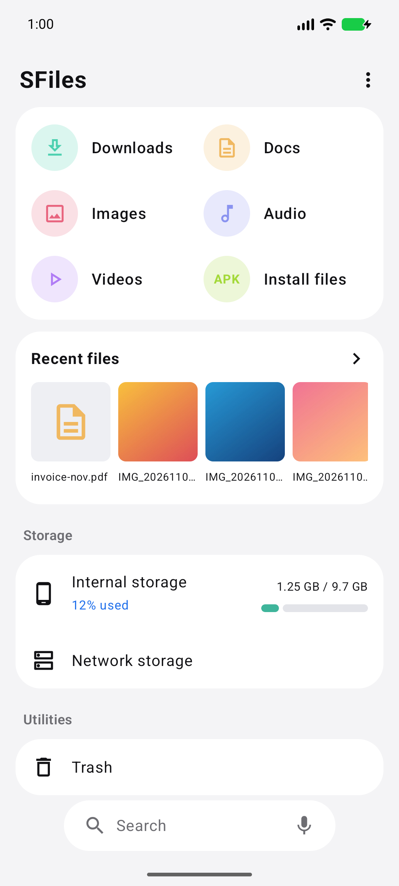
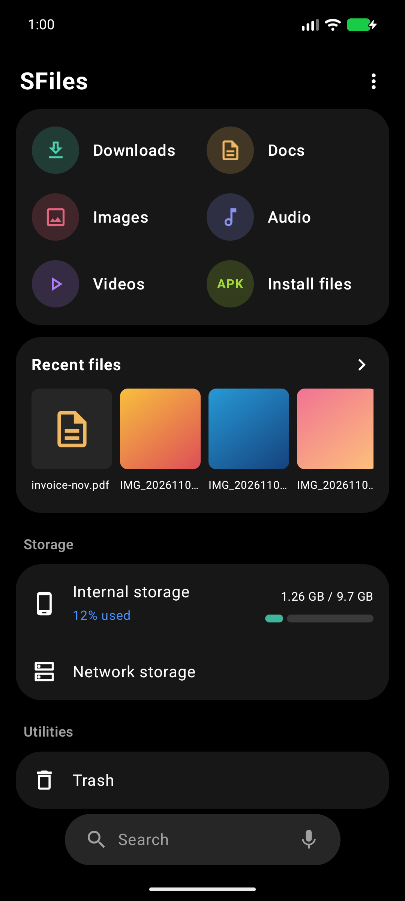
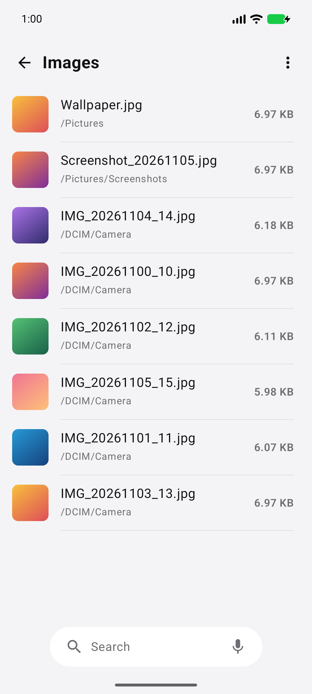
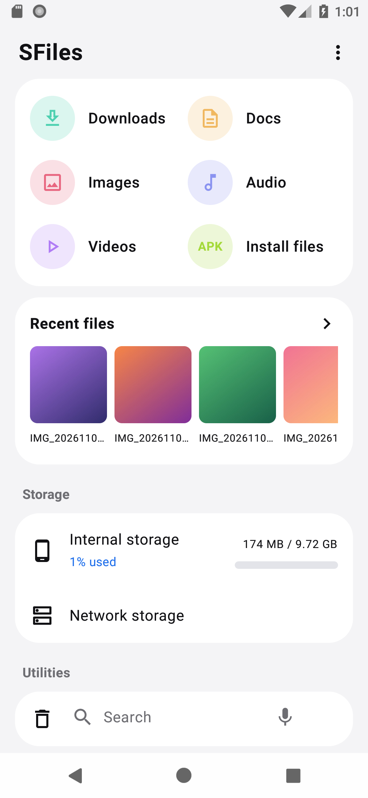
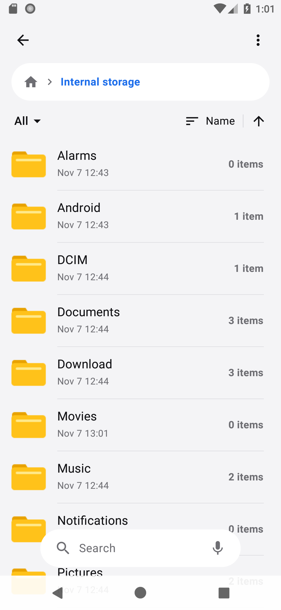
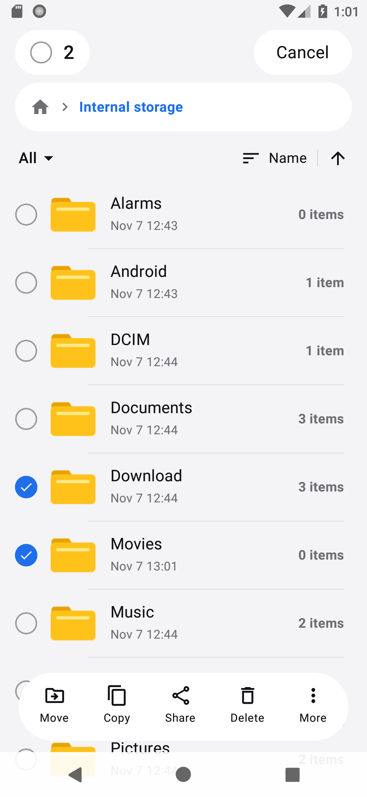

# SFiles

A fast, clean file manager for Android, built with Kotlin and Jetpack Compose.

## Download

Get the latest signed APK from the [Releases page](https://github.com/ibuds/sfiles/releases/latest), then open it on your phone. Android will ask you to allow installs from your browser or file app the first time.

## Screenshots

Captured on Android 8.0 (the minimum supported version) and Android 17.

| Home (Android 17) | Home, dark (Android 17) | Images (Android 17) |
| --- | --- | --- |
|  |  |  |

| Home (Android 8) | Folders (Android 8) | Selection (Android 8) |
| --- | --- | --- |
|  |  |  |

## Features

- Home screen with category shortcuts (Downloads, Docs, Images, Audio, Videos, Install files), recent files and storage usage
- Folder browser with breadcrumb, filter, sorting and list view
- Multi-select: long-press, then drag across rows to select a range
- Move, copy, share, delete, rename, compress (zip) and file details
- Progress for copy, move, compress, delete and restore, in the app and in a notification, with a Cancel button
- Several operations at once, each with its own card and notification, remaining time and item count
- Favorites on Home, and Hide / Unhide for any file or folder
- Unmount and Format shortcuts for USB drives and SD cards (long-press the drive on Home, or use the menu inside it); Android only allows these from system Settings, so SFiles opens the right screen
- Trash with 30-day retention (internal storage); permanent delete on removable drives
- USB drives and SD cards shown with their filesystem (FAT32, exFAT, NTFS)
- Network storage: FTP, SFTP and SMB (v2/v3) with browse, open, download, upload, rename, delete
- Hidden files toggle (Hide renames an item to start with `.`) and a Hide file extensions toggle
- Search across storage, with voice input
- Light, dark and follow-device themes

SFiles never creates folders on removable drives on its own.

## Build

Requirements: JDK 17 and the Android SDK (platform 35, build-tools 35).

```bash
# point Gradle at your SDK
echo "sdk.dir=/path/to/android/sdk" > local.properties

./gradlew assembleDebug      # debug APK
./gradlew assembleRelease    # release APK (needs signing config, see below)
```

The debug APK is written to `app/build/outputs/apk/debug/`.

### Release signing

Release builds read `signing/keystore.properties`, which is git-ignored:

```properties
storeFile=../signing/your-release.jks
storePassword=...
keyAlias=...
keyPassword=...
```

Without that file, `assembleRelease` produces an unsigned APK.

## Permissions

SFiles requests "All files access" (`MANAGE_EXTERNAL_STORAGE`) because browsing and managing every folder is the core purpose of a file manager. Nothing is uploaded anywhere; network storage connects only to servers you add yourself. Saved passwords are stored encrypted on the device.

## Project layout

| File | Purpose |
| --- | --- |
| `MainActivity.kt` | Navigation, permission gate, voice search |
| `HomeScreen.kt` | Home screen |
| `BrowserScreen.kt` | Folder and category browser, selection mode, dialogs |
| `Fs.kt` | Local file operations, volumes, trash, formatting |
| `Remote.kt`, `RemoteScreens.kt` | FTP / SFTP / SMB layer and screens |
| `Common.kt`, `Ui.kt`, `Theme.kt` | Shared header, menu, action bar, progress card and palette |
| `OpService.kt` | Foreground service and task list behind progress cards and notifications |
| `Extra.kt`, `Picker.kt`, `SearchScreen.kt` | Trash, settings, folder picker, search |

## License

Apache License 2.0. See [LICENSE](LICENSE).
